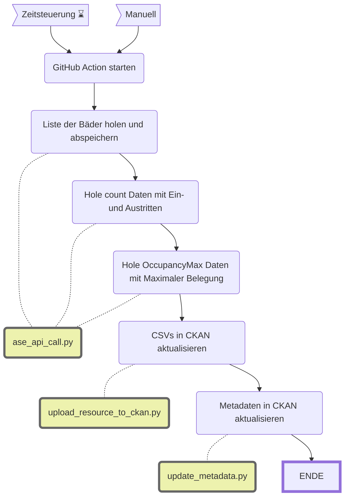

Badi Besuch (ASE)
====================

|                           | Beschreibung                                                                                                                                                                                                                                                           |
| ------------------------- | ---------------------------------------------------------------------------------------------------------------------------------------------------------------------------------------------------------------------------------------------------------------------- |
| **Status:**         |  |
| **Workflow:**       | [`update_badi_besuch.yml`](https://github.com/opendatazurich/opendatazurich.github.io/blob/master/.github/workflows/update_badi_besuch.yml)                                                                                                            |
| **Quelle:**         | [ASE Diamond API](https://arlas.ase.solutions/)                               |
| **Datensatz INT:**  | [Badi Besuchende (data.integ.stadt-zuerich.ch)](https://data.integ.stadt-zuerich.ch/dataset/ssd_spo_badi_besuch)                                                                                                              |
| **Datensatz PROD:** | [Badi Besuchende (data.stadt-zuerich.ch)](https://data.stadt-zuerich.ch/dataset/ssd_spo_badi_besuch)                                                                                                                          |

Dieser Workflow lädt Daten von der [ASE Diamond API](https://arlas.ase.solutions/). Details zur Schnittstelle finden sich hier: https://arlas.ase.solutions/v2/swagger/index.html

Das Skript [**`ase_api_call.py`**](ase_api_call.py) steuert den gesamten Ablauf:
- Authentifizierung
- Die infrage kommenden Bäder werden über den Endpoint `Location` geholt, bereinigt und als CSV abgelegt.
- Für jede Location werden Daten der Endpoints `count` (Ein- und Austritte) und `OccupancyMax` (Maximale Belegung) geholt und in einer Tabelle kombiniert
- Die Daten werden als CSV exportiert

Über [**`ase_parameters.py`**](ase_parameters.py) können verschiedene Einstellungen gemacht werden. Hier werden die wichtigsten erklärt:
- `LOCAL_EXECUTION`: Damit die Ausführung lokal auf den Rechnern von SSZ funktioniert, muss ein Proxy verwendet werden und die Requests können nicht verfiziert werden. Lokal sollte also `True` verwendet werden, sonst `False`.
- `GRANULARITY_TO_USE`: Legt fest, in welcher Granularität die Daten abgefragt werden. Mit dem Sportamt abgestimmt sind `FiveMinutes`. Das heisst die Daten werden in Fünf-Minuten-Abschnitten Gruppiert. Von der Granularität hängt auch ab, wie viele Daten aus der Vergangenheit man beziehen kann (siehe dazu `GRANULARITY_RANGE`).
- `VALID_LOCATIONS`: Es sollen nicht alle Locations verwendet werden (einige davon sind keine Bäder). Das ist die Liste der erwünschten Bäder
- `SUFFIX_TO_REMOVE`: Einige Bäder haben einen Suffix: " (Bis Mai 2026)". Das Sportamt ist sich nicht sicher, wieso der vorhanden ist und er soll entfernt werden.

## Jahres-Akkumulator

Zum Live-Feed (5-Tage-Fenster) steht ein **Jahres-Akkumulator** zur Verfügung: die Dateien mit dem laufenden Jahr werden regelmässig aktualisiert, indem die frischsten 5 Tage hintendran gehängt werden.

- Der Ablauf ([`ase_ckan_year_accumulate.py`](ase_ckan_year_accumulate.py)) macht **keine Calls an die ASE-API**. Die frischen Daten werden aus der vom Live-Feed gepflegten 5-Tage-CSV im CKAN gezogen, der bisherige Akkumulator aus der Jahressource (Parquet).
- Ablauf: beide Dateien aus CKAN laden → zusammenführen → Dubletten entfernen (`LocationId`, `LocationName`, `Datetime`) → auf das laufende Jahr filtern → als `Badi_Besuch_{jahr}.csv` + `Badi_Besuch_{jahr}.parquet` schreiben.
- Ausgelöst wird das über den Workflow [`update_badi_besuch_jahr.yml`](https://github.com/opendatazurich/opendatazurich.github.io/blob/master/.github/workflows/update_badi_besuch_jahr.yml). Der Workflow läuft automatisch **täglich** (01:00 UTC) und hängt täglich ~1 neuen Tag an. Da stets 5 Tage im CKAN verfügbar sind, fallen ausgefallene Durchläufe nicht ins Gewicht.
- Der Datensatz wird als **zwei zusätzliche Ressourcen (Parquet + CSV) im gleichen CKAN-Datensatz** `ssd_spo_badi_besuch` hochgeladen und dort überschrieben. Bei Jahreswechsel startet die neue Jahressource leer und wächst wieder von vorne; die alte bleibt als Archiv erhalten.
- Manuell per `workflow_dispatch` startbar.

## Backfill: direkter API-Zugriff (optional)

Neben dem regulären Ablauf ist [**`ase_year_backfill.py`**](ase_year_backfill.py) als optionales Werkzeug **erhalten geblieben**. Es wird nicht über einen Workflow angestossen, kann aber manuell verwendet werden, wenn Daten **direkt aus der ASE-API** für einen bestimmten Zeitraum abgefragt werden sollen – z.B. für historische Lücken, die der Akkumulator nicht abdeckt, oder für beliebig wählbare Fenster.

- Es holt die Datenfensterweise in der Granularität aus [`ase_parameters.py`](ase_parameters.py) (`GRANULARITY_RANGE`, Standard `FiveMinutes`) und schreibt Parquet + CSV.
- Zielzeitraum steuerbar über Env-Variablen: `BACKFILL_YEAR` (gesamtes Jahr, z.B. `2024`), oder `BACKFILL_START`/`BACKFILL_END` (YYYYMMDD, z.B. `20250601`/`20250607`) für ein beliebiges Zeitfenster.
- Ausgabe: `Badi_Besuch_{jahr}.csv` + `Badi_Besuch_{jahr}.parquet` neben dem Skript. Der Lauf macht API-Calls und ist deshalb nicht für die häufige, regelmässige Aktualisierung gedacht (dafür dient der [Jahres-Akkumulator](#jahres-akkumulator)).

