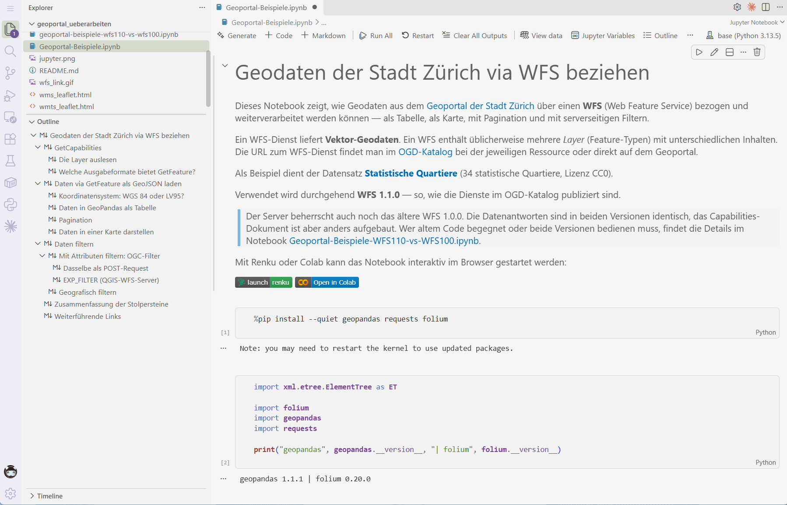

# Geoportal

Diese Dokumentation zeigt, wie man offene Geodaten der Stadt Zürich programmatisch bezieht und darstellt — per HTTP-Request, in Python oder JavaScript, ohne GIS-Software.
Grundlage sind die Geo-Webservices des [Geoportals](https://www.stadt-zuerich.ch/geodaten/): **WFS** für Vektordaten mit Attributen, **WMS** und **WMTS** für gezeichnete Kartenbilder.
Alle Dienste sind offen zugänglich — ohne Anmeldung und ohne API-Key.

Konkrete Beispiele befinden sich im selben Ordner als lauffähiges Jupyter-Notebook: [Geoportal-Beispiele.ipynb](Geoportal-Beispiele.ipynb).
Ohne lokale Installation läuft es direkt im Browser — mit Renku oder Colab, [wie unten beschrieben](#3-programmier-beispiele-python):

[](https://renkulab.io/p/opendatazurich/github-jupyter/sessions/01M3PPQJDDQZ4YD7CD7DZ5S5ER/start?GITHUB_FILEPATH=opendatazurich/opendatazurich.github.io/blob/master/geoportal/Geoportal-Beispiele.ipynb)
[](https://colab.research.google.com/github/opendatazurich/opendatazurich.github.io/blob/master/geoportal/Geoportal-Beispiele.ipynb)

Nicht Thema sind GIS-Programme wie QGIS — dazu gibt es [unsere Werkstatt](https://www.stadt-zuerich.ch/de/politik-und-verwaltung/statistik-und-daten/open-government-data/werkstatt.html) — und der manuelle Download einzelner Datensätze, den das Geoportal direkt anbietet (GeoJSON, GPKG, Shapefile, CSV, DXF).

**Inhaltsverzeichnis**

1. [Daten via WFS beziehen](#1-daten-via-wfs-beziehen)
   1. [WFS-URL finden](#wfs-url-finden)
   2. [GetCapabilities](#getcapabilities)
   3. [Layer auswählen](#layer-auswählen)
   4. [GetFeature](#getfeature)
   5. [Koordinatensystem: WGS 84 oder LV95](#koordinatensystem-wgs-84-oder-lv95)
   6. [Serverseitig filtern](#serverseitig-filtern)
   7. [Pagination](#pagination)
2. [WMS und WMTS in Leaflet einbinden](#2-wms-und-wmts-in-leaflet-einbinden)
   1. [Der einfache Weg (mit Qualitätsverlust)](#der-einfache-weg-mit-qualitätsverlust)
   2. [WMS mit EPSG:2056 (LV95)](#wms-mit-epsg2056-lv95)
   3. [WMTS mit EPSG:2056 (LV95)](#wmts-mit-epsg2056-lv95)
3. [Programmier-Beispiele (Python)](#3-programmier-beispiele-python)
4. [Häufige Stolpersteine](#4-häufige-stolpersteine)

## 1. Daten via WFS beziehen

Ein **WFS** (Web Feature Service) liefert Vektor-Geodaten — Punkte, Linien, Flächen mit Attributen.
Die Daten sind in Feature-Typen (*Layer*) gegliedert.

### WFS-URL finden

Am einfachsten über den [OGD-Katalog](https://data.stadt-zuerich.ch/dataset?res_format=WFS): dort sind alle Datensätze mit WFS-Ressource aufgeführt.
Die WFS-URL steht bei der Ressource «Web Feature Service». Alternativ findet man den Link ganz unten auf der Geoportal-Seite des Datensatzes:


In dieser Dokumentation wird der Datensatz [**Statistische Quartiere**](https://data.stadt-zuerich.ch/dataset/geo_statistische_quartiere) verwendet (34 Quartiere, Lizenz CC0).

Die zugehörigen Dienste, mit den im OGD-Katalog publizierten Versionen:

| Dienst | Version | URL |
|---|---|---|
| WFS | 1.1.0 | `https://www.ogd.stadt-zuerich.ch/wfs/geoportal/Statistische_Quartiere` |
| WMS | 1.3.0 | `https://www.ogd.stadt-zuerich.ch/wms/geoportal/Statistische_Quartiere` |
| WMTS | 1.0.0 | `https://www.ogd.stadt-zuerich.ch/mapproxy/wmts/1.0.0/WMTSCapabilities.xml` |

Bei WFS und WMS wird die Version als Parameter `VERSION=` mitgegeben, beim WMTS ist sie Teil der URL.

### GetCapabilities

Alle Informationen zum Server liefert der `GetCapabilities`-Aufruf:

[https://www.ogd.stadt-zuerich.ch/wfs/geoportal/Statistische_Quartiere?SERVICE=WFS&REQUEST=GetCapabilities&VERSION=1.1.0](https://www.ogd.stadt-zuerich.ch/wfs/geoportal/Statistische_Quartiere?SERVICE=WFS&REQUEST=GetCapabilities&VERSION=1.1.0)

Das zurückgelieferte XML enthält:

* die verfügbaren Layer (Feature-Typen)
* die unterstützten Operationen und Parameter
* die unterstützten Ausgabeformate
* die Koordinatensysteme

Ein Hinweis dazu: bei diesem Server ist `<DefaultSRS>` **leer**. Das Koordinatensystem lässt sich also nicht aus den Capabilities ablesen, man muss es beim Abruf selbst festlegen — siehe [Koordinatensystem](#koordinatensystem-wgs-84-oder-lv95).

> Der Server unterstützt auch noch das ältere **WFS 1.0.0**. Das Capabilities-Dokument ist dort anders aufgebaut, was beim Umstieg Anpassungen nötig macht.
> Die Unterschiede sind im Notebook [geoportal-beispiele-wfs110-vs-wfs100.ipynb](geoportal-beispiele-wfs110-vs-wfs100.ipynb) gegenübergestellt.

### Layer auswählen

Die Layer sind im [OGD-Katalog](https://data.stadt-zuerich.ch/dataset/geo_statistische_quartiere) beschrieben; die kompletten Metadaten liegen auf [geocat.ch](https://www.geocat.ch/geonetwork/srv/ger/catalog.search#/metadata/fd1a94fe-4bd4-4a40-99af-8b859dfe82a7) (Link «Komplette Metadaten ansehen» auf dem Geoportal).

Beim Datensatz «Statistische Quartiere» gibt es aktuell drei Layer:

* `adm_statistische_quartiere_b_p`
* `adm_statistische_quartiere_map`
* `adm_statistische_quartiere_v`

Zum Layer `adm_statistische_quartiere_map` heisst es:

> Dieser Layer kann für Datenvisualisierungen und kartographische Darstellungen verwendet werden.
> Er enthält die vollständige Attributtabelle und ist generalisiert, sprich: die Geometrie wurde
> vereinfacht und entspricht nicht der – aus Sicht der amtlichen Vermessung – korrekten Lage.

Für Visualisierungen ist das also der passende Layer. Für lagegenaue Auswertungen dagegen nicht:
dafür ist `adm_statistische_quartiere_v` gedacht.

Der WFS liefert diese Attribute (in Kleinschreibung):

| Attribut | Bedeutung |
|---|---|
| `geometry` | Geometriefeld (Polygon) |
| `kname` | Name des Stadtkreises |
| `knr` | Offizielle ID des Stadtkreises |
| `qname` | Name des Statistischen Quartiers |
| `qnr` | Offizielle ID des Statistischen Quartiers |
| `objectid` | interner System-Identifikator, **nicht stabil über Zeit** |
| `geometrie_gdo` | im GeoJSON-Export durchgehend leer |

Zum Verknüpfen mit anderen Datensätzen eignen sich `qnr` bzw. `knr` — `objectid` ist dafür nicht geeignet.

### GetFeature

Mit `GetFeature` werden die eigentlichen Daten bezogen, zum Beispiel als GeoJSON:

[https://www.ogd.stadt-zuerich.ch/wfs/geoportal/Statistische_Quartiere?service=WFS&version=1.1.0&request=GetFeature&typename=adm_statistische_quartiere_map&outputFormat=GeoJSON](https://www.ogd.stadt-zuerich.ch/wfs/geoportal/Statistische_Quartiere?service=WFS&version=1.1.0&request=GetFeature&typename=adm_statistische_quartiere_map&outputFormat=GeoJSON)

Die angebotenen Ausgabeformate sind:

| Parameterwert | Inhalt |
|---|---|
| `GeoJSON` bzw. `application/vnd.geo+json` | GeoJSON |
| `text/xml; subtype=gml/3.1.1` | GML 3.1.1 |
| `text/xml; subtype=gml/2.1.2` | GML 2.1.2 |

In den Capabilities ist GeoJSON als `application/vnd.geo+json` deklariert; der Kurzname `GeoJSON` wird ebenfalls akzeptiert und ist bequemer zu schreiben.

### Koordinatensystem: WGS 84 oder LV95

* **Ohne** `srsName` kommt GeoJSON in **EPSG:4326** (WGS 84, Grad). So verlangt es die GeoJSON-Spezifikation, und das ist das Format, das Leaflet und folium direkt verstehen.
* **Mit** `srsName=EPSG:2056` kommt **LV95** (Meter) — passend zu den übrigen städtischen Geodaten und nötig, wenn man in Metern rechnen will (Flächen, Distanzen, Puffer).

```
...&outputFormat=GeoJSON&srsName=EPSG:2056
```

### Serverseitig filtern

Filtern lohnt sich: der Server liefert dann nur die benötigten Features.

**OGC-Filter** werden als XML über den Parameter `Filter` übergeben:

```
...&outputFormat=GeoJSON&Filter=<Filter><PropertyIsEqualTo><PropertyName>knr</PropertyName><Literal>7</Literal></PropertyIsEqualTo></Filter>
```

> ✅ Mit dieser Schreibweise — **Filter ohne `xmlns`-Deklaration** — treten keine Fehler wie HTTP 403 oder 500 auf. Der QGIS-Server versteht den Filter auch ohne Namespaces.
>
> Für längere oder verschachtelte Filter den Request als **POST** senden (XML im Body): dort sind vollständige Namespaces problemlos und man ist nicht an die maximale URL-Länge gebunden.

**EXP_FILTER:** Der verwendete QGIS-WFS-Server unterstützt zusätzlich den herstellerspezifischen Parameter `EXP_FILTER` mit SQL-ähnlicher Syntax — deutlich kompakter:

```
...&outputFormat=GeoJSON&EXP_FILTER=qname LIKE 'H%'
```

Mögliche Ausdrücke: `field = 10`, `field_a > 10`, `field_b > 10 AND field_c <= 7`, `field_d LIKE 'H%'`

**Geografisch filtern** geht am einfachsten mit dem Standard-Parameter `bbox` in der Form `minx,miny,maxx,maxy[,CRS]`:

```
...&outputFormat=GeoJSON&bbox=2684454,1245344,2687039,1247714,EPSG:2056
```

`bbox` und `EXP_FILTER` lassen sich kombinieren. Beispiele dazu im [Jupyter-Notebook](Geoportal-Beispiele.ipynb).

### Pagination

Liefert ein WFS sehr viele Features, bezieht man die Daten portionenweise mit `startIndex` und `maxFeatures`:

```
...&outputFormat=GeoJSON&startIndex=5&maxFeatures=1
```

Die Gesamtzahl verrät ein `GetFeature`-Request mit `resultType=hits`: er liefert eine leere FeatureCollection, dafür mit dem Attribut `numberOfFeatures`.

> In WFS 2.0.0 heisst der Parameter `count` statt `maxFeatures`. Dieser Server ignoriert `count` — bei 1.1.0 also `maxFeatures` verwenden.

## 2. WMS und WMTS in Leaflet einbinden

Hier wird gezeigt, wie sich die angebotenen WMS und WMTS in [Leaflet](https://leafletjs.com/) integrieren lassen.
Komplette, lauffähige Beispiele:

* [WMS in Leaflet](https://opendatazurich.github.io/geoportal/wms_leaflet.html) ([Quellcode](https://github.com/opendatazurich/opendatazurich.github.io/blob/master/geoportal/wms_leaflet.html))
* [WMTS in Leaflet](https://opendatazurich.github.io/geoportal/wmts_leaflet.html) ([Quellcode](https://github.com/opendatazurich/opendatazurich.github.io/blob/master/geoportal/wmts_leaflet.html))

Als Hintergrundkarte dient die [Basiskarte Zürich Raster Grau](https://data.stadt-zuerich.ch/dataset/geo_basiskarte_zuerich_raster_grau).

> **Wichtig — der Layer-Name:** Der WMS-Layer heisst **`wmslayers`**, *nicht* wie der Dienst `Basiskarte_Zuerich_Raster_Grau`.
> Mit einem falschen Layer-Namen antwortet der Server mit **HTTP 500** und die Karte bleibt leer.
> Die gültigen Layer-Namen stehen in den [WMS-Capabilities](https://www.ogd.stadt-zuerich.ch/wms/geoportal/Basiskarte_Zuerich_Raster_Grau?SERVICE=WMS&REQUEST=GetCapabilities&VERSION=1.3.0).
> Der Dienst unterstützt `EPSG:2056`, `EPSG:3857`, `EPSG:4326` und `CRS:84` sowie die Formate `image/png` und `image/jpeg`.

### Der einfache Weg (mit Qualitätsverlust)

Grundsätzlich bindet man einen WMS in Leaflet mit `L.tileLayer.wms` ein:

```javascript
var map = L.map('mapid').setView([47.36, 8.53], 13);
L.tileLayer.wms('https://www.ogd.stadt-zuerich.ch/wms/geoportal/Basiskarte_Zuerich_Raster_Grau', {
   layers: 'wmslayers',
   version: '1.3.0'
}).addTo(map);
```

**ACHTUNG:** Das funktioniert, hat aber einen Nachteil. Die städtischen Dienste liefern ihre Tiles in EPSG:2056 (LV95), und LV95 ist von Leaflet standardmässig **nicht** unterstützt. Leaflet arbeitet mit EPSG:3857, der WMS muss also reprojizieren — **dadurch ist die Qualität der Tiles deutlich reduziert.**

Besser ist, Leaflet um LV95 zu erweitern. Dazu werden [`proj4js`](http://proj4js.org/) und [`proj4leaflet`](http://kartena.github.io/Proj4Leaflet/) benötigt:

```html
<link rel="stylesheet" href="https://unpkg.com/leaflet@1.9.4/dist/leaflet.css" />
<script src="https://unpkg.com/leaflet@1.9.4/dist/leaflet.js"></script>
<script src="https://cdnjs.cloudflare.com/ajax/libs/proj4js/2.6.2/proj4.js"></script>
<script src="https://cdnjs.cloudflare.com/ajax/libs/proj4leaflet/1.0.2/proj4leaflet.js"></script>
```

### WMS mit EPSG:2056 (LV95)

--> [**Komplettes Beispiel WMS in Leaflet**](https://opendatazurich.github.io/geoportal/wms_leaflet.html) ([_Quellcode_](https://github.com/opendatazurich/opendatazurich.github.io/blob/master/geoportal/wms_leaflet.html))

```html
<!DOCTYPE html>
<html>
   ...

   <div id="mapid" style="width: 1200px; height: 800px; max-width: 100%;"></div>

   <script>
   // Definiere LV95
   var lv95 = {
       epsg: 'EPSG:2056',
       def: '+proj=somerc +lat_0=46.95240555555556 +lon_0=7.439583333333333 +k_0=1 +x_0=2600000 +y_0=1200000 +ellps=bessel +towgs84=674.374,15.056,405.346,0,0,0,0 +units=m +no_defs',
       resolutions: [ 4000, 3750, 3500, 3250, 3000, 2750, 2500, 2250, 2000, 1750, 1500, 1250, 1000, 750, 650, 500, 250, 100, 50, 20, 10, 5, 2.5, 2, 1.5, 1, 0.5, 0.2, 0.1],
       origin: [2420000, 1350000]
   };
   var crs = new L.Proj.CRS(lv95.epsg, lv95.def, {
       resolutions: lv95.resolutions,
       origin: lv95.origin
   });
   var map = new L.Map('mapid', {
       crs: crs,
       maxZoom: crs.options.resolutions.length,
       minZoom: 16,
   }).setView([47.365, 8.54], 22);

   L.tileLayer.wms('https://www.ogd.stadt-zuerich.ch/wms/geoportal/Basiskarte_Zuerich_Raster_Grau', {
      layers: ['wmslayers'],
      version: '1.3.0',
      maxZoom: crs.options.resolutions.length,
      minZoom: 0
   }).addTo(map);
   </script>
   ...
</html>
```

### WMTS mit EPSG:2056 (LV95)

Ein **WMTS** liefert vorgerenderte Tiles — schneller als ein WMS, aber nur in den vordefinierten Zoomstufen.
Die Stadt Zürich stellt den WMTS über MapProxy bereit; der Tile-Matrix-Set heisst `ktzh` und hat 11 Zoomstufen bei einer Tile-Grösse von 512 Pixel.
Die verfügbaren Layer stehen in den [WMTS-Capabilities](https://www.ogd.stadt-zuerich.ch/mapproxy/wmts/1.0.0/WMTSCapabilities.xml).
Die `1.0.0` im Pfad ist die WMTS-Protokollversion und Teil der festen URL-Struktur — sie ist nicht mit der WMS-Version 1.3.0 zu verwechseln.

--> [**Komplettes Beispiel WMTS in Leaflet**](https://opendatazurich.github.io/geoportal/wmts_leaflet.html) ([_Quellcode_](https://github.com/opendatazurich/opendatazurich.github.io/blob/master/geoportal/wmts_leaflet.html))

```html
<!DOCTYPE html>
<html>
   ...

   <div id="mapid" style="width: 1200px; height: 800px; max-width: 100%;"></div>

   <script>
   // Definiere LV95 -- Auflösungen und Origin stammen aus den WMTS-Capabilities (TileMatrixSet "ktzh")
   var lv95 = {
       epsg: 'EPSG:2056',
       def: '+proj=somerc +lat_0=46.95240555555556 +lon_0=7.439583333333333 +k_0=1 +x_0=2600000 +y_0=1200000 +ellps=bessel +towgs84=674.374,15.056,405.346,0,0,0,0 +units=m +no_defs',
       resolutions: [67.7333333333, 33.8666666667, 16.9333333333, 8.4666666667, 4.2333333333, 2.1166666667, 1.0583333333, 0.5291666667, 0.2645833333, 0.1322916667, 0.0661458333],
       origin: [2480237.0, 1315832.0],
       bounds:  L.bounds( [2480237.000000, 1062032.000000], [2846837.000000, 1315832.000000])
   };
   var crs = new L.Proj.CRS(lv95.epsg, lv95.def, {
       resolutions: lv95.resolutions,
       origin: lv95.origin
   });
   var map = new L.Map('mapid', {
       crs: crs,
       maxZoom: crs.options.resolutions.length,
   }).setView([47.365, 8.54], 4);

   L.tileLayer('https://www.ogd.stadt-zuerich.ch/mapproxy/wmts/1.0.0/Basiskarte_Zuerich_Raster_Grau/default/ktzh/{z}/{y}/{x}.png', {
      maxZoom: crs.options.resolutions.length,
      tileSize: 512
   }).addTo(map);
   </script>
   ...
</html>
```

Die Tile-URL folgt dem Muster `.../{Layer}/default/{TileMatrixSet}/{TileMatrix}/{TileRow}/{TileCol}.png` — in Leaflet-Schreibweise also `{z}/{y}/{x}`.

## 3. Programmier-Beispiele (Python)

[](Geoportal-Beispiele.ipynb)

Im [Jupyter-Notebook Geoportal-Beispiele.ipynb](Geoportal-Beispiele.ipynb) sind die Python-Beispiele ausführlich gezeigt:

* `GetCapabilities` auswerten
* Daten via `GetFeature` als GeoJSON beziehen
* GeoJSON in **GeoPandas** als Tabelle weiterverarbeiten
* Flächen in LV95 berechnen
* Pagination mit `resultType=hits`, `startIndex`, `maxFeatures`
* Karten mit **folium** und der städtischen Basiskarte als WMS-Hintergrund
* Filtern mit OGC-Filter (GET und POST), `EXP_FILTER` und `bbox`

Verwendete Pakete: `requests`, `geopandas`, `folium`.

Im selben Verzeichnis liegt zusätzlich das Notebook
[geoportal-beispiele-wfs110-vs-wfs100.ipynb](geoportal-beispiele-wfs110-vs-wfs100.ipynb).
Es stellt **WFS 1.1.0 und WFS 1.0.0** gegenüber und zeigt, worauf beim Umstieg zu achten ist.

Jupyter-Notebook interaktiv im Browser starten:
[](https://renkulab.io/p/opendatazurich/github-jupyter/sessions/01M3PPQJDDQZ4YD7CD7DZ5S5ER/start?GITHUB_FILEPATH=opendatazurich/opendatazurich.github.io/blob/master/geoportal/Geoportal-Beispiele.ipynb)
[](https://colab.research.google.com/github/opendatazurich/opendatazurich.github.io/blob/master/geoportal/Geoportal-Beispiele.ipynb)

## 4. Häufige Stolpersteine

| Problem | Ursache | Lösung |
|---|---|---|
| Koordinatensystem aus den Capabilities ist leer | Server füllt `DefaultSRS` nicht aus | CRS selbst setzen: GeoJSON ist EPSG:4326, LV95 via `srsName=EPSG:2056` |
| `JSONDecodeError: Expecting value: line 1 column 1` beim Filtern | `xmlns` im GET-Parameter → HTTP 403 der Firewall | `xmlns` weglassen oder POST verwenden |
| Fehler bei `crs={'init': 'EPSG:4326'}` in GeoPandas | Dict-Schreibweise ist seit pyproj 2 veraltet | `crs="EPSG:4326"` |
| Karte bleibt leer, WMS antwortet mit HTTP 500 | falscher WMS-Layer-Name | `layers='wmslayers'` |
| `count` wirkt nicht | `count` ist WFS 2.0.0 | `maxFeatures` verwenden |
| Unscharfe Hintergrundkarte in Leaflet | WMS muss von LV95 nach EPSG:3857 reprojizieren | Leaflet mit `proj4leaflet` um EPSG:2056 erweitern |
| Layer `adm_statistische_quartiere_a` nicht gefunden | existiert nicht mehr | `adm_statistische_quartiere_map` verwenden |
